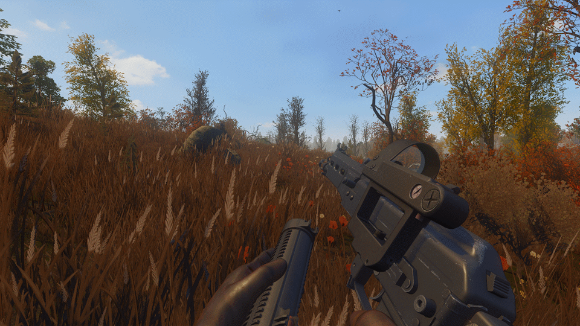
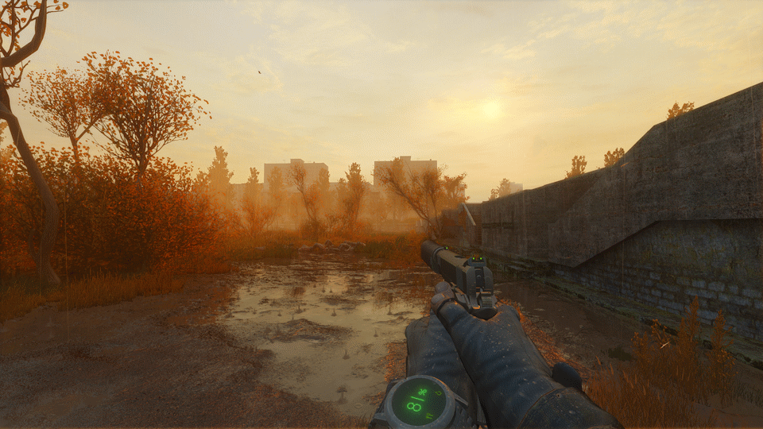
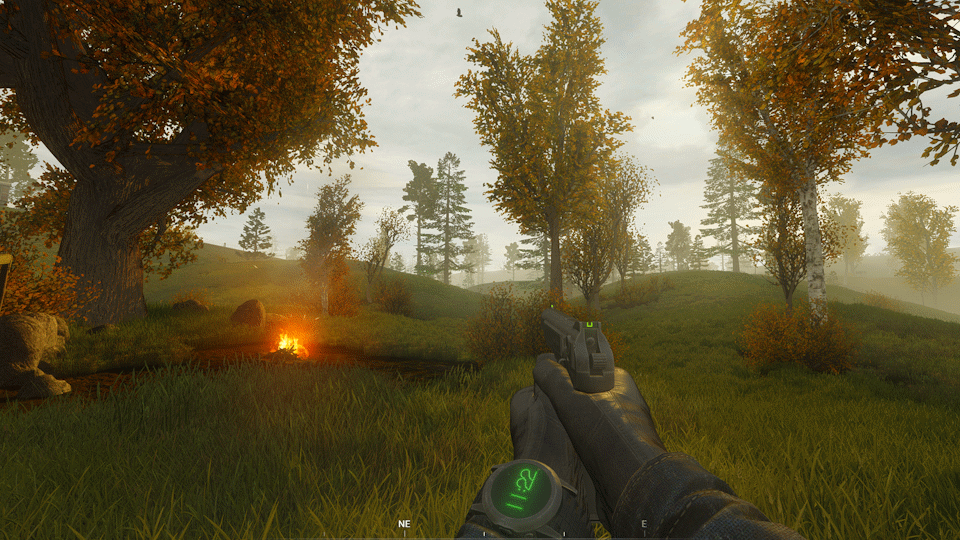

# Secret Trails{style="text-align: center;"}

::: buttons
[Discord](https://discord.gg/tQNPCEC469) [YouTube](https://www.youtube.com/@I-amdead) [GitHub](https://github.com/I-AmDead/Secret-Trails)
:::

**Автор проекта:** I am dead  
**Платформа:** OGSR Engine

**Secret Trails** — дополненная и улучшенная версия оригинального мода. За счёт улучшенного движка удалось повысить качество геймплея, добавить новые возможности, подтянуть графическую составляющую и повысить стабильность проекта!

## Изменения{style="text-align: center;"}

В проекте улучшены качество геймплея, графическая составляющая и стабильность; добавлены новые возможности.

## Скриншоты{style="text-align: center;"}

Показать скриншоты (5)

## Благодарности{style="text-align: center;"}

Спасибо всем, кто участвовал в создании и поддержке проекта!
